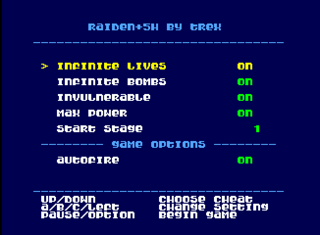
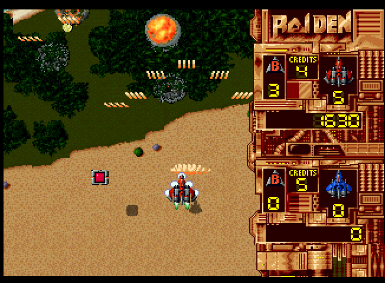
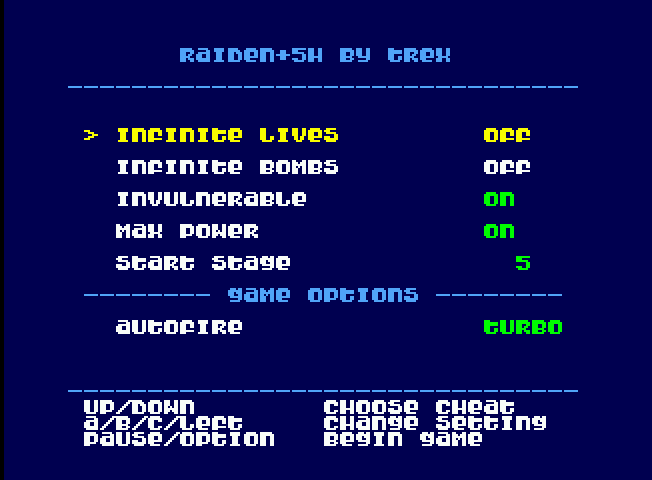
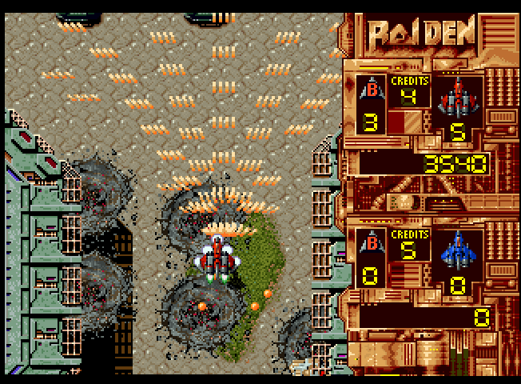

# Atari Jaguar ROM hacks by TREX

Trainers and patches for Atari Jaguar games. Each game has its own folder with IPS patches, a README and the source. No ROMs are included; apply the patches to your own clean dump.

| Game | Version | What it adds |
|---|---|---|
| [Raiden (World)](raiden/) | V1 | Trainer menu: infinite lives, infinite bombs, invulnerable, max power, start stage 1-8, and autofire (OFF / ON / TURBO). Also an autofire-only patch. Runs on real hardware at the original 2 MB. |

> **Emulators need the official Atari Jaguar BIOS (boot ROM)** to run these patched ROMs. Real hardware and flash carts already have it.

## Raiden

  
  

  
  

Full details, downloads and the write-up on how it was done: [raiden/](raiden/)
