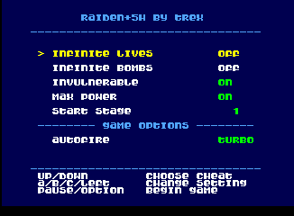
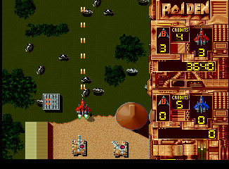

# Raiden (World), Atari Jaguar: RAIDEN+5H BY TREX, V1

A trainer for the Atari Jaguar version of Raiden. It adds a trainer menu before the game starts, in the same style as the TREX SNES trainers, with five cheats and an autofire option. It runs on real hardware (2 MB ROM, boots through the real Jaguar boot ROM) and in emulators. The game's own Hall of Aces high score table, which already saves to the cart EEPROM, keeps working.



## Downloads

Only IPS patches are here, never ROMs. Apply them to your own dump of the clean ROM.

| Patch | What you get |
|---|---|
| [`Raiden (World) [TREX+5H]V1.ips`](release/) | The full trainer: menu with the 5 cheats and autofire |
| [`Raiden (World) [Autofire]V1.ips`](release/) | No menu, autofire always ON, otherwise the original game |

| File | CRC32 | Size |
|---|---|---|
| Clean ROM: `Raiden (World).j64` (not Rev A) | `0509C85E` | 2,097,152 |
| `Raiden (World) [TREX+5H]V1.j64` after patching | `2849DAF5` | 2,097,152 |
| `Raiden (World) [Autofire]V1.j64` after patching | `4C428152` | 2,097,152 |

Rev A (`31812799`) is not supported. Its packed data differs throughout.

## The trainers

| Line | Values | What it does |
|---|---|---|
| INFINITE LIVES | OFF / ON | Losing a ship doesn't cost a life. |
| INFINITE BOMBS | OFF / ON | Dropping a bomb doesn't use one up. |
| INVULNERABLE | OFF / ON | Enemy bullets and collisions pass straight through you. |
| MAX POWER | OFF / ON | Main shot is always at level 8, and missiles are at full strength as soon as you pick some up. |
| START STAGE | 1 to 8 | A new game starts on the chosen stage. |
| *Game options* | | |
| AUTOFIRE | OFF / ON / TURBO (default ON) | Hold A or B to keep firing. **ON** fires as fast as the game's own shot cooldown allows, the same as perfect tapping. **TURBO** ignores the cooldown and fires every other game frame. It looks great, but it can glitch sprites and crash on real hardware with max power (see below), so use it at your own risk. |

Controls in the menu: Up/Down pick a line, A/B/C/Right next value, Left previous value, Pause or Option starts the game.

The cheats only take effect in a real game; the attract demos play exactly as in the original. If any cheat is on (including a start stage other than 1), your score won't be entered in the Hall of Aces, so the saved table stays honest. Autofire is a game option, not a cheat, so it doesn't block saving.



## How it was done

### Getting in: a hook in the boot stub

Raiden's game files sit in a table at `$809000`, packed with RNC1. A small boot stub (copied to `$180000`) unpacks the main program to RAM at `$3000` and finishes with `st.b $2c6(a4) / jmp $3000.w`. The patch changes that pair (file offset `$2138`) to `jmp $801000 / nop`, so the trainer menu runs after the game is unpacked but before it starts.

The menu is a 320x240 8 bpp bitmap with its own object list, rebuilt every VBL, with the video mode switched to RGB16 while it's up. When you leave the menu, it puts the stub's state back (video mode, black palette, VBL vector, stop object), patches only the hooks for the options you turned on into the game code in RAM, and jumps to `$3000`. With everything off, the game runs untouched.

| RAM address | Original code | Hook |
|---|---|---|
| `$240EE` | `tst.w $19CE8.l` before lives -1 | infinite lives |
| `$2307C` | `tst.w $19CE8.l` before bombs -1 | infinite bombs |
| `$1FB12` | `tst.b $745(a3) / beq hit` (player collision) | invulnerability |
| `$22B6E` | `move.b #1,$3442(a4)` (new game stage) | start stage |
| `$23A66` / `$23B24` | `jsr $19A22` / `jsr $19A6E` (P1/P2 fire) | autofire and max power |
| `$188AA` | `bmi.w $189CC` (score not in table) | skip the Hall of Aces when a cheat is on |

`$19CE8` is the flag of a debug cheat left in the game: hold keypad 1+4+7+3+6+9 and Option during play for infinite lives and bombs, then press a keypad digit to jump to that stage. The lives and bombs hooks reuse its checks.

The trainer's variables live at `$2F00-$2F1F`. The game never touches `$2000-$2FFF`, which was checked over the attract mode and all 8 stages.

### Red screen on real hardware: the universal header

The first build worked in emulators but not on a real Jaguar: Jaguar logo, roar, then a red screen. The Jaguar boot ROM checks the cart's encrypted header against a hash of the whole 2 MB ROM, so changing even one byte fails the check. That was reproduced in Virtual Jaguar running the real boot ROM.

The fix is the homebrew "universal header" in the first 8 KB (`$800000-$801FFF`). It has the same ROM config (`04 04 04 04`) and the same `$802000` start address as the original, and it boots any code. In the original, the bytes from `$400` to `$1FFF` were only padding.

### Keeping it at 2 MB

The original ROM is completely full, so the first build put the roughly 2 KB of trainer code past the end. Carts come in 2 MB and 4 MB sizes, so the file doubled to 4 MB. The universal header turned out to have 4 KB of spare space at `$801000-$801FFF`, so the code moved there and the ROM is back to exactly 2 MB, the same size as the original.

### Toning down the autofire: too many sprites

The first autofire skipped the game's shot cooldown and fired every other game frame. In play-testing on real hardware, with invulnerability, max power and autofire all on, it gave sprite glitches after a while on stage 1 and a crash on stage 4 (black screen, music frozen).

Counting the objects on screen showed why. Fast autofire with max power puts up to **104** sprites on screen at once. The clean ROM, tapped by hand at full power, peaks at **75**. The Jaguar's Object Processor builds every scanline from the object list in real time, and the game was never designed for that many bullets. Emulators don't model the Object Processor's time limits, which is why it looked fine there.

So autofire became a three-way choice:

* **ON** (the default) holds fire 2 game frames on and 2 off. That's exactly as fast as the game's cooldown accepts shots, the same as a perfect tapper, and the sprite count stays close to the original (82 at most).
* **TURBO** keeps the old cooldown-skipping speed for anyone who wants it, with the warning above.
* **OFF** is the original game.

### High scores

Raiden already saves the Hall of Aces and its options to the cart's 128-byte 93C46 serial EEPROM: at boot (load, or write defaults) and after each name entry. Words 0 to 3 hold the magic `NC` and the options, words 4 to 48 hold the 10 entries, and word 63 holds a checksum. Emulators and flash carts keep this as the save file, so no new high score table was needed. The trainer only makes sure that a game played with cheats is never entered.

### Testing

Everything was tested headless in the Virtual Jaguar libretro core with scripted bots (`test/`):

* `cheats.py`: a bot holds fire for 3000 frames. With no cheats it lost 2 ships and bombs went down. Lives ON kept 5 lives, bombs ON kept 3 bombs, invulnerable ON gave 0 deaths, max power ON kept the shot at level 8.
* `stages.py`: each start stage 1 to 8 opens on the right stage. With invulnerability and max power on for 4000 frames, nothing died, the hooks stayed in place and `$2000-$2FFF` stayed clean.
* `demo.py`: with all cheats on, the 5 attract demos match the clean ROM.
* `hs.py`: a clean run enters the table and the EEPROM changes, and the table loads again at the next boot. The same run with a cheat on doesn't enter the table and leaves the EEPROM unchanged.
* `lag.py`: over 6000 frames of stage 1, the counts of logic frames and late frames match the clean ROM (clean 2858/58, trainer all off 2857/55, autofire only 2858/55). Max power adds a few late frames because of the bigger weapon on screen, the same as the clean ROM with full power.

## Building

```
python3 build.py "Raiden (World).j64"
python3 mkips.py "Raiden (World).j64" "release/Raiden (World) [Trainer].j64" out.ips
```

Needs Python 3 and `binutils-m68k-linux-gnu`. The source is `src/trainer.s` (68000 assembly). The test scripts expect the Virtual Jaguar libretro core in `VJCORE`.
